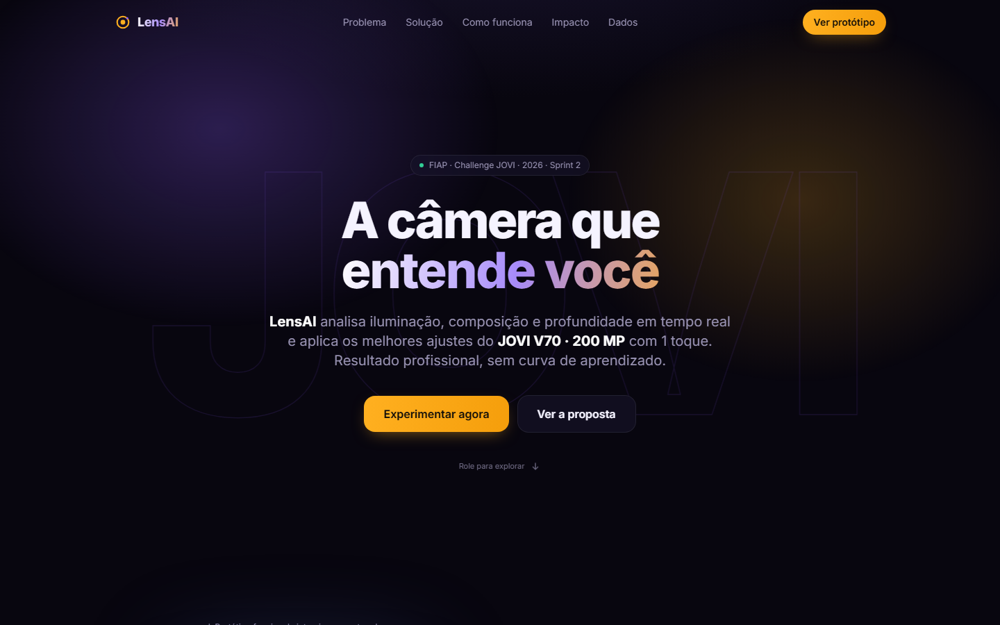
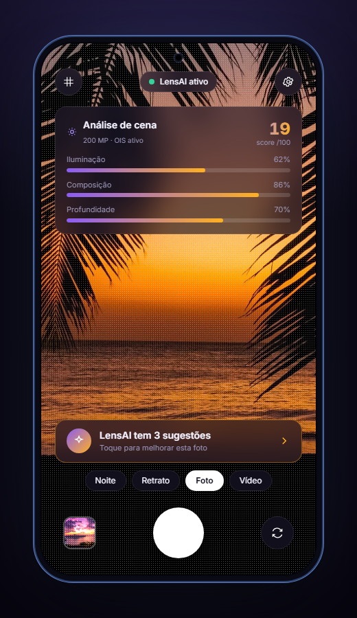
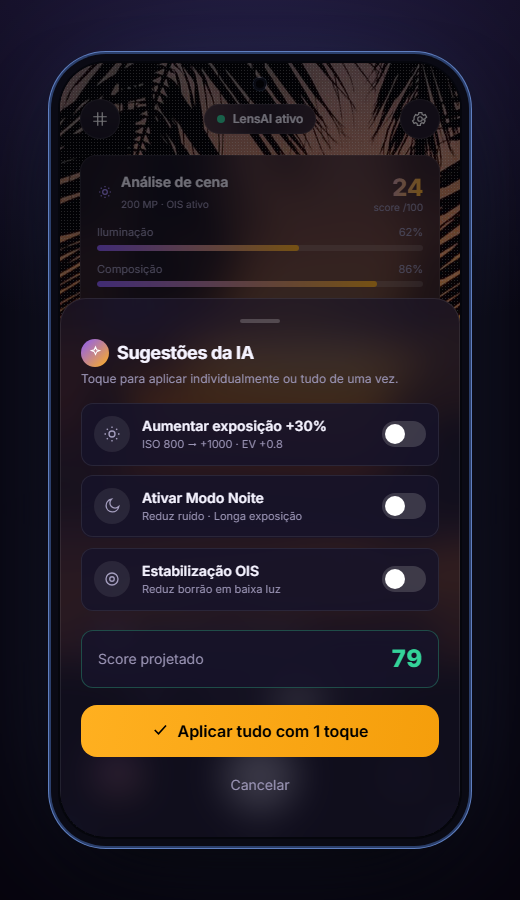
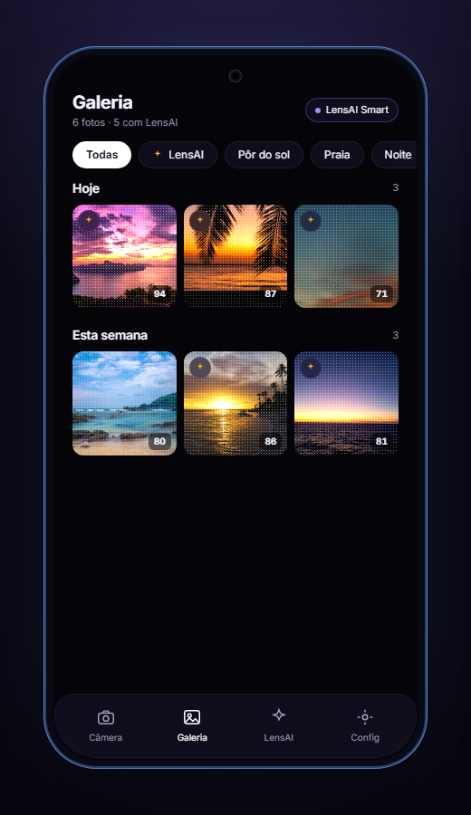
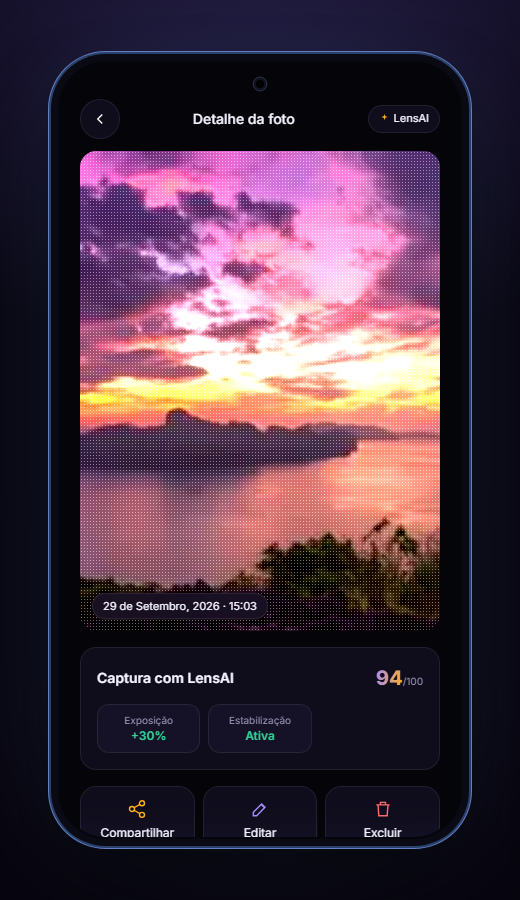

# 📸 LensAI · the camera that understands you

> **FIAP · 1TDS · JOVI Challenge 2026**. An AI camera assistant for the **JOVI V70 5G (200 MP)** smartphone, built 100% for the web and designed mobile first.


### ▶️ [Open the live prototype](https://zhobbit.github.io/challenge-jovi-lensai/sprint-2/LensAI-Sprint2/)



## ✨ Technologies

- `HTML5`
- `CSS3`
- `JavaScript`
- `Tailwind CSS` (bundled locally, works offline)
- `Figma` (Sprint 1 prototype)

## 🎯 The Challenge

JOVI asked for a **100% web**, responsive, mobile-first digital solution. The goal is to improve the camera and content experience on the brand's smartphones, increasing engagement and **perceived performance**. The solution has to simulate capturing, viewing and sharing photos, and reduce user frustration with slowness and complexity.

**The problem:**

- **68%** of users never touch the camera's manual settings.
- "Weak camera" complaints are **3x** more frequent, even though the hardware (200 MP, OIS) is top tier.
- Settings like ISO, EV and color temperature are too complex, so users end up blaming the device.

## 🚀 Features

- **Real-time scene analysis** - Reads **lighting**, **composition** and **depth**
- **AI suggestions** - Recommends the best settings (exposure, Night Mode, OIS stabilization…) and applies them with **one tap**
- **Photo score** - Every shot gets a **0 to 100 score**, so users learn what improved instead of fixing things blindly
- **Smart Gallery** - Browse and review photos with their analysis
- **Fully offline** - No build, no dependencies, no internet needed

| Camera + analysis | AI suggestions | Smart Gallery | Photo details |
|:-:|:-:|:-:|:-:|
|  |  |  |  |

## 📍 The Process

| Sprint | Deliverable | Status | Docs |
|---|---|---|---|
| **1** | Business case, data model (ERD) and Figma prototype | ✅ Delivered 05/20/2026 · **grade 10/10** | [docs/sprint-1](docs/sprint-1/README.md) |
| **2** | Working web front end (HTML, CSS, JS, Tailwind) and PDF presentation | ✅ Delivered 09/2026 | [docs/sprint-2](docs/sprint-2/README.md) |

📖 The full development process, with the timeline, decisions, problems and solutions, is in [docs/PROCESSO.md](docs/PROCESSO.md) *(Portuguese)*.

📦 The delivery packages (ZIP) are in **[Releases](../../releases)**.

## 🚦 Running the Project

**Online:** the prototype is published at https://zhobbit.github.io/challenge-jovi-lensai/sprint-2/LensAI-Sprint2/ (GitHub Pages).

**Locally:** no build, dependencies or internet needed. Tailwind and the Inter font ship inside the `vendor/` folder.

**Option 1:** double-click [`sprint-2/LensAI-Sprint2/index.html`](sprint-2/LensAI-Sprint2/index.html).

**Option 2:** use a local server:

```bash
cd sprint-2/LensAI-Sprint2
python -m http.server 8000
```

Then open `http://localhost:8000`. To see it as on a phone, open DevTools (F12) and turn on device mode (Ctrl+Shift+M).

### Capture mode (screenshots)

These parameters open a specific screen directly and hide the landing page. They were used to generate the presentation images:

```
index.html?kiosk=1&screen=camera     # camera + scene analysis
index.html?kiosk=1&screen=suggest    # AI suggestions bottom sheet
index.html?kiosk=1&screen=gallery    # smart gallery
index.html?kiosk=1&screen=photo      # photo details
```

## 📁 Repository Structure

```
challenge-jovi-lensai/
├── README.md                  ← you are here
├── docs/
│   ├── PROCESSO.md            ← development process
│   ├── sprint-1/              ← business case, ERD, Figma screens, Sprint 1 PDF
│   └── sprint-2/              ← front end, design system, screenshots, Sprint 2 PDF
└── sprint-2/LensAI-Sprint2/   ← web prototype source code
```

## 👤 Author

**Victor Holanda** · FIAP 1TDS · 2026
